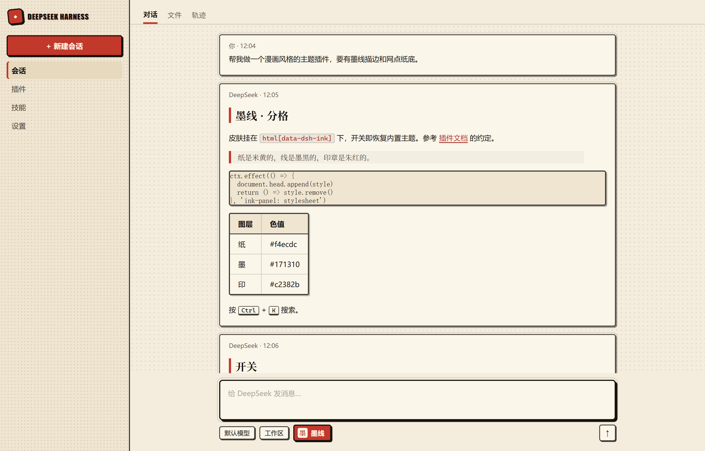
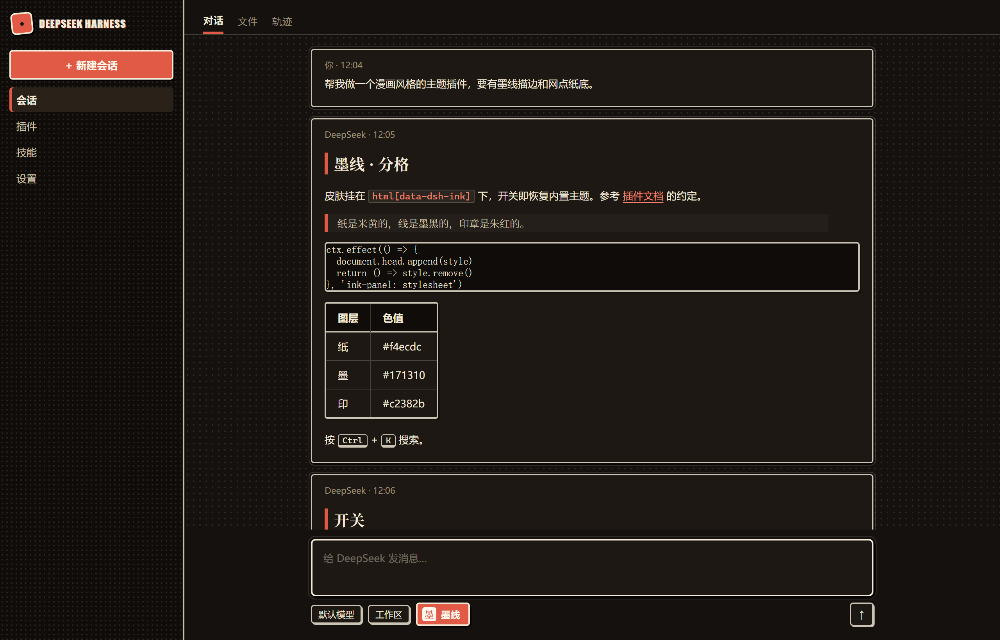

# dsh-ink-panel

[](https://github.com/Brokenheart100/dsh-ink-panel/actions/workflows/ci.yml)
[](https://github.com/Brokenheart100/dsh-ink-panel/actions/workflows/release.yml)

墨线漫画主题插件（DeepSeek Harness）。米黄纸底 + 墨黑描边 + 硬投影 + 网点，配一枚朱红「墨」印章开关；另有「夜墨」深色纸色可手动切换或跟随外观。




> 上图为界面示意：同一份 `src/styles/` 与本地 mock 页面渲染，用于确认实际视觉效果，非实机截图。

## 目录

```
dsh-ink-panel/
├─ icon.svg                插件图标
├─ index.js                Host 端入口（纯浏览器样式，空实现）
├─ cordis.patch.yml        bundle 挂载声明
├─ package.json            bundle + client 元数据
├─ client.js               构建产物（浏览器侧，样式与脚本已内联）
├─ locale/{zh,en}.json     插件管理器里展示的标题 / 描述 / 详情
├─ docs/
│  ├─ DETAIL.md            详情页文档
│  ├─ preview.png          宣纸（day）渲染示意
│  └─ preview-night.png    夜墨（night）渲染示意
├─ scripts/
│  ├─ build.mjs            拼接样式与模块 → client.js
│  └─ check.mjs            契约、调色板与状态机自检（node:vm）
└─ src/
   ├─ styles/              12 个按文件名排序拼接的样式片段
   │  ├─ 00-palette.css    两套纸色的唯一来源（day 与 night 都在这）
   │  ├─ 10-tokens.css     --dsw-* 令牌桥接
   │  ├─ 20-shell.css      … 80-lightbox.css
   │  ├─ 90-plugin-ui.css  插件自身的开关 / 三段选择器
   │  └─ 99-responsive.css 窄屏与动画偏好降级
   └─ client/
      ├─ index.template.js 浏览器侧入口，__THEME_CSS__ / __CLIENT_CODE__ 为注入点
      ├─ 00-state.js       开关、纸色、跟随外观与监听
      ├─ 10-copy.js        中英文案
      ├─ 20-views.js       印章按钮、设置行、三段选择器
      └─ 30-apply.js       ctx.effect / locale / slots 注册
```

## 开发

源码在 `src/`，产物是根目录的 `client.js`（样式与脚本都以内联字符串打包，避免运行时再取文件）。产物里的 CSS 按样式文件分组、**每条 CSS 行对应一条字符串**（文件前带 `/* src/styles/00-palette.css */` 注释），所以 `client.js` 基本能当样式表读、改一行 CSS 只动一行产物；它仍是机器生成的，不要手改。

```bash
cd dsh-ink-panel
node scripts/build.mjs     # 重新生成 client.js
node scripts/check.mjs     # 契约 + 调色板 + 状态机自检
```

改 `src/` 下任何文件后都要重新构建，否则改动不会进入插件。`check.mjs` 会验证：只有 `00-palette.css` 允许出现字面量颜色、night 覆盖块存在、表格内边距、模块契约（`__ModuleLoader__` 的 id / inject / 清理函数 / 两个 slot）、以及「手动夜墨 / 跟随外观 / 关闭 / 卸载」四种状态。

## 安装

1. 打开 **插件（Plugins）** 页；
2. 选择 **Add plugin** → 安装本地目录，指向本仓库根目录（绝对路径）；
3. 安装完成后重启应用（或重载窗口）。

插件没有 host 逻辑，不会启动后台服务；样式与开关全部在浏览器侧完成。

## 开关与纸色

- 设置 → 通用 → 「墨线漫画主题」：开关 + 「跟随外观 / 宣纸 / 夜墨」；
- 或点输入框下方的「墨」印章。

状态存于 localStorage 的 `dsh.ink-panel.enabled` 与 `dsh.ink-panel.mode`。

## 兼容

DeepSeek Harness 0.2.x（开发验证：0.2.2-rc.3）。

## CI 与发布

仓库带两条 GitHub Actions 工作流：

- **CI**（`.github/workflows/ci.yml`）：push 到 `main`、PR 或手动触发时，用 `node scripts/build.mjs --check` 校验提交进仓库的 `client.js` 与 `src/` 是否一致（不一致直接失败，提示重新构建）；随后跑 `scripts/check.mjs` 的契约 / 调色板 / 状态机断言，并校验 `package.json`、两份 locale 与 `meta.detail` 指向的文档存在。
- **Release**（`.github/workflows/release.yml`）：推送 `v*` 标签时先校验标签与 `package.json` 版本一致，再校验产物、跑检查，打成 `dsh-ink-panel-vX.Y.Z.zip` 并创建 GitHub Release（自动生成变更说明）。

本地等价命令：

```bash
npm run build            # 重新生成 client.js（改过 src/ 后必须跑）
npm run verify           # = build --check + check，不写文件
```

发版：

```bash
npm version patch        # 改版本号并打 tag
git push && git push --tags
```

## 许可

MIT。见 [LICENSE](LICENSE)。

## 致谢

视觉方向参考了 dsh-comic-skin（MIT）的工程做法——按形态匹配 CSS Modules 类名、`data-` 属性开关、输入框贴纸入口；配色、两套纸色的令牌体系与全部 CSS 规则为本项目原创。
